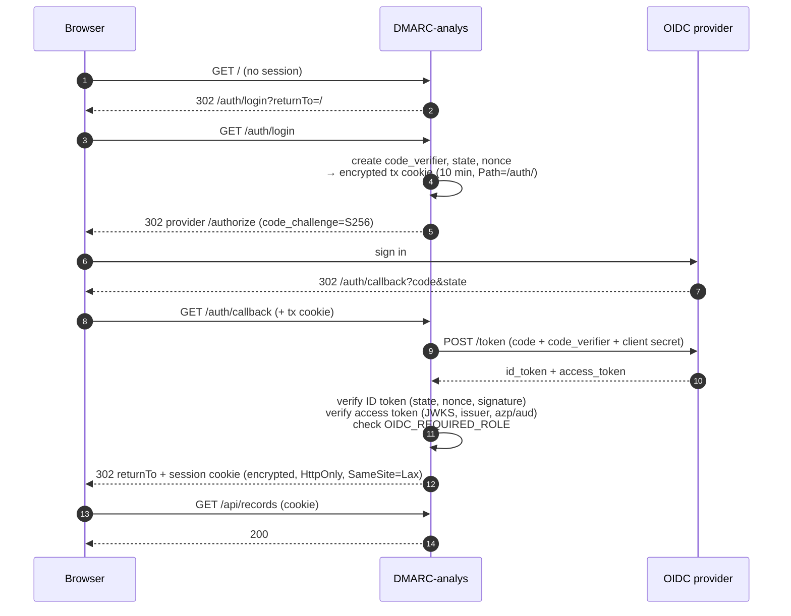

# Authentication

Since **2.0.0**, DMARC-analys authenticates users itself with **OpenID Connect**. You don't
need an authenticating proxy (oauth2-proxy, gateway auth plugins, …). Any standards-compliant
provider works. Keycloak is the reference, and docker-compose ships with one.

Code: [`src/auth/`](../src/auth/). Tests: [`test/auth.test.js`](../test/auth.test.js), which
runs against an in-process mock provider.

## Overview

| Who | How they authenticate | Where it's checked |
|-----|-----------------------|--------------------|
| Browser (the web UI) | Authorization code flow with **PKCE (S256)**, `state` and `nonce` → encrypted session cookie | `src/auth/index.js` → `requireAuth` |
| API clients (`curl`, scripts) | `Authorization: Bearer <access token>` from the same provider | `verifyAccessToken` |
| Kubernetes probes | No authentication: `/healthz` is public | – |

Users only: there are no API keys or service accounts. A script calls the API with a user's
access token.



## Sessions

- **Stateless and encrypted.** The session is a JWE (`dir` + `A256GCM`) with a key derived from
  `SESSION_SECRET`. It holds only `sub`, `name`, `preferred_username`, `email` and roles, never
  provider tokens. Any replica can validate it, so you need no session store and no sticky
  sessions.
- **Lifetime** is `SESSION_TTL_SECONDS` (default 8 h, fixed, not sliding). After it expires,
  the UI restarts the login flow. If the user still has a session at the provider, that happens
  without a password prompt.
- **Cookie attributes:** `HttpOnly`, `SameSite=Lax`, `Path=/`. When `APP_BASE_URL` is https,
  the cookie is also `Secure` and uses the `__Host-` prefix (`__Host-dmarc_session`).
- **Revocation:**
  - Logging out clears the cookie.
  - Rotating `SESSION_SECRET` invalidates **all** sessions at once.
  - Disabling a user or removing their role at the provider takes effect at their next login,
    at most `SESSION_TTL_SECONDS` later. Bearer tokens are checked on every request.
- **Purpose binding:** the login-transaction cookie and the session cookie are encrypted with
  different `pur` claims, so neither can be replayed as the other.

## Bearer tokens

A bearer token is accepted when **all** of these hold:

1. It's a JWT signed by a key in the provider's JWKS, using an asymmetric algorithm
   (RS\*, PS\*, ES\* or EdDSA).
2. `iss` equals the issuer from discovery, and `exp`/`sub` are present and valid (with 30 s of
   clock tolerance).
3. It's an access token: ID tokens (`typ: ID`) and refresh tokens are rejected.
4. The audience rule passes. If `OIDC_AUDIENCE` is set, `aud` must contain it. Otherwise `azp`
   must equal `OIDC_CLIENT_ID`, meaning the token was issued to this application.
5. If `OIDC_REQUIRED_ROLE` is set, the role appears in `OIDC_ROLE_CLAIM`.

Bearer requests skip the CSRF check, because browsers never attach them automatically.

## Authorization

`OIDC_REQUIRED_ROLE` (for example `dmarc-viewer`) restricts access to users holding that role.
`OIDC_ROLE_CLAIM` is a dotted path into the **access token** claims:

| Provider setup | `OIDC_ROLE_CLAIM` |
|----------------|-------------------|
| Keycloak realm roles (default) | `realm_access.roles` |
| Keycloak client roles | `resource_access.dmarc-analysis.roles` |
| Group membership (Keycloak "groups" mapper, Entra ID, Authentik, …) | `groups` |

Leave `OIDC_REQUIRED_ROLE` empty to allow every user the provider authenticates. That's only
appropriate when the realm or tenant contains nobody else.

Every authorized user has the same rights: they can upload reports and view all records.

## CSRF and other protections

| Threat | Mitigation |
|--------|------------|
| Cross-site request forgery | `SameSite=Lax` cookies. On top of that, cookie-authenticated `POST`/`PUT`/`PATCH`/`DELETE` requests must carry `Origin` equal to `APP_BASE_URL`, or `Sec-Fetch-Site: same-origin`. Otherwise the app returns `403 CSRF_REJECTED`. |
| Authorization-code interception or injection | PKCE S256, `state` and `nonce`, all held in a single-use encrypted cookie that expires after 10 minutes |
| Open redirect via `returnTo` | Only local paths are allowed; `//host`, absolute URLs and `/\` are replaced with `/` |
| Forced logout | Logout is `POST` + same-origin, not a link |
| Token or session theft via XSS | Cookies are `HttpOnly`, the UI renders data with `textContent` only, and the strict CSP has no inline scripts |
| Downgrade to http | `OIDC_ISSUER_URL` and `APP_BASE_URL` must be https. Plain http is accepted only for `localhost`, `*.localhost` and loopback IPs. |
| Large unauthenticated requests | Body parsing happens **after** authentication |

## Configuration

| Variable | Required | Source | Description |
|----------|----------|--------|-------------|
| `APP_BASE_URL` | yes | ConfigMap | Public origin of the app, e.g. `https://dmarc.example.com` (no path). Redirect URI = `APP_BASE_URL/auth/callback` |
| `OIDC_ISSUER_URL` | yes | ConfigMap | Issuer; `/.well-known/openid-configuration` must be reachable below it |
| `OIDC_CLIENT_ID` | yes | ConfigMap | Confidential client ID |
| `OIDC_CLIENT_SECRET` | yes | **Secret** | Client secret |
| `SESSION_SECRET` | yes | **Secret** | At least 32 characters; e.g. `openssl rand -base64 48` |
| `OIDC_SCOPES` | no | ConfigMap | Default `openid profile email` |
| `OIDC_REQUIRED_ROLE` | no | ConfigMap | Required role/group; empty means any authenticated user |
| `OIDC_ROLE_CLAIM` | no | ConfigMap | Default `realm_access.roles` |
| `OIDC_AUDIENCE` | no | ConfigMap | Require this `aud` on bearer tokens, instead of `azp == OIDC_CLIENT_ID` |
| `SESSION_TTL_SECONDS` | no | ConfigMap | Default `28800` (8 h) |

The app refuses to start if a required value is missing or invalid, and lists every problem.
Provider discovery is lazy: the pod starts and stays ready even when the provider is down, and
logins return `503 IDENTITY_PROVIDER_UNAVAILABLE` until the provider is back.

## Setting up the provider client (Keycloak)

1. Create a client with **Client authentication ON** (confidential) and only **Standard flow**
   enabled.
2. Set **Valid redirect URIs** to `https://dmarc.example.com/auth/callback`.
3. Set **Valid post logout redirect URIs** to `https://dmarc.example.com/`.
4. Under *Advanced*, set **PKCE method** to `S256`.
5. Create the realm role `dmarc-viewer` and assign it to the users or groups who need access.
6. Copy the client secret into the Kubernetes Secret as `OIDC_CLIENT_SECRET`.

The local realm in [`dev/keycloak/dmarc-realm.json`](../dev/keycloak/dmarc-realm.json) is a
complete example. It also enables *Direct access grants*, but **only** so you can fetch a token
with `curl` locally. Leave that off in production.

## Getting a token for scripts

Use any flow your provider supports for a **user** of this client, for example the device
authorization grant. Locally, the password grant against the dev realm is the quickest:

```bash
TOKEN=$(curl -s -d grant_type=password -d client_id=dmarc-analysis -d client_secret=local-dev-changeme-client-secret -d username=analyst -d password=changeme-analyst http://keycloak.localhost:8081/realms/dmarc/protocol/openid-connect/token | jq -r .access_token)
```

```bash
curl -s -H "Authorization: Bearer $TOKEN" http://localhost:8080/api/records?days=all | jq .count
```

If a separate CLI client should call the API, give its tokens an audience mapper that adds
e.g. `dmarc-api`, and set `OIDC_AUDIENCE=dmarc-api`. Note that this then applies to **all**
bearer tokens, including those for the web client.

## Logout

`POST /auth/logout` clears the session cookie. It returns the provider's `end_session_endpoint`
URL, with `client_id` and `post_logout_redirect_uri`, and the UI navigates there. Keycloak asks
the user to confirm, because the app doesn't keep an `id_token_hint` (that keeps the cookie
small). If the provider has no end-session endpoint, the user is simply sent back to `/`.
